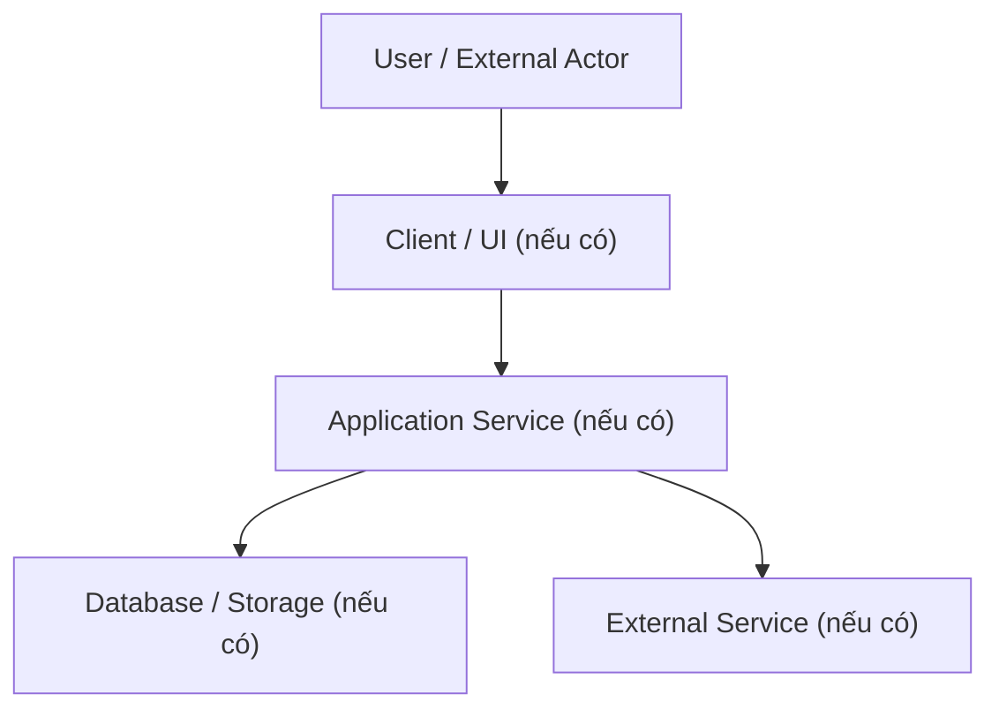

# System Architecture

- **Trạng thái:** Draft – chưa xác minh stack và cấu trúc triển khai.

## 1. Kiến trúc hiện tại
Chưa đủ dữ liệu để mô tả kiến trúc thực tế. Cần rà soát source, manifest, cấu hình, Docker/CI và sơ đồ triển khai trước khi kết luận.

## 2. Khung sơ đồ thành phần

Các thành phần trong sơ đồ là khung tham khảo, không phải bằng chứng về thành phần đã được triển khai.

## 3. Cần ghi nhận khi xác minh
- Thành phần và trách nhiệm của từng module.
- Giao thức và ranh giới giữa các thành phần.
- Cách cấu hình môi trường và quản lý secret.
- Xác thực, phân quyền, logging và giám sát.
- Chiến lược triển khai, backup và phục hồi.
