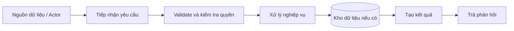

# Data Flow

- **Trạng thái:** Template – chưa xác nhận từ source code.

## 1. Luồng dữ liệu mức cao

Đây là luồng khái quát để thảo luận; không khẳng định ứng dụng thực tế có các thành phần này.

## 2. Mô tả luồng chi tiết

| Bước | Đầu vào | Xử lý | Đầu ra | Cần xác minh |
|---|---|---|---|---|
| 1 | Request/event | Nhận yêu cầu | Dữ liệu đầu vào | Entry point thực tế |
| 2 | Dữ liệu đầu vào | Validate, authn/authz nếu áp dụng | Dữ liệu hợp lệ hoặc lỗi | Quy tắc và mã lỗi |
| 3 | Dữ liệu hợp lệ | Xử lý nghiệp vụ | Kết quả | Module chịu trách nhiệm |
| 4 | Lệnh đọc/ghi | Truy cập kho dữ liệu nếu có | Bản ghi/kết quả | Schema, transaction |
| 5 | Kết quả | Chuẩn hóa response | Response/event | Contract thực tế |

## 3. Luồng lỗi cần tài liệu hóa
- Dữ liệu không hợp lệ.
- Chưa xác thực hoặc không đủ quyền.
- Không tìm thấy tài nguyên.
- Xung đột dữ liệu.
- Timeout hoặc dịch vụ phụ thuộc không khả dụng.

Chỉ giữ các trường hợp phù hợp với hệ thống sau khi xác minh.
