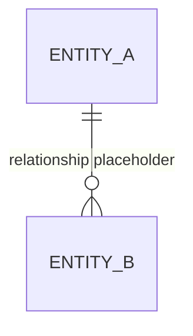

# Data Model / Database Design

- **Trạng thái:** Chưa xác minh – chưa có schema trong repository đã kiểm tra.

## 1. ERD
Chưa vẽ ERD nghiệp vụ vì chưa có migration, schema hoặc model làm căn cứ.

Sơ đồ trên chỉ minh họa cú pháp Mermaid. Xóa hoặc thay bằng entity và quan hệ thực tế trước khi dùng làm tài liệu chính thức.

## 2. Danh mục bảng/entity

| Tên | Mục đích | Khóa chính | Quan hệ | Nguồn xác minh |
|---|---|---|---|---|
| TBD | Chưa xác định | TBD | TBD | Entity/model/migration cần kiểm tra |

## 3. Với mỗi bảng/entity, ghi
- Tên cột/thuộc tính, kiểu dữ liệu và nullable.
- Primary key, foreign key, unique/check constraints.
- Index và lý do sử dụng.
- Quy tắc xóa/cập nhật và tính toàn vẹn.
- Phân loại dữ liệu nhạy cảm, thời hạn lưu giữ và chính sách backup.
