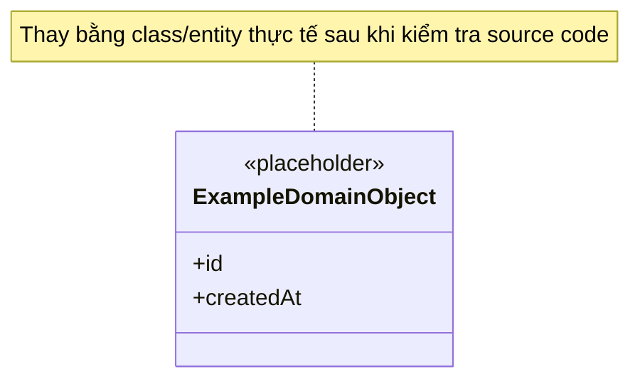

# UML Class Diagram

- **Trạng thái:** Template – chưa có source code để xác định class thực tế.

## Hướng dẫn cập nhật
- Dùng tên class, thuộc tính và phương thức đúng với source code.
- Thể hiện association, multiplicity, inheritance và composition khi có căn cứ.
- Không suy luận entity chỉ từ tên dự án.
- Nếu mô hình dữ liệu khác mô hình đối tượng, duy trì sơ đồ ERD riêng trong `docs/data/`.
