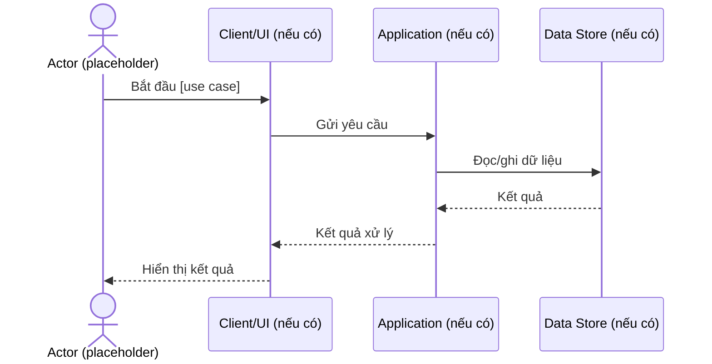

# UML Sequence Diagram

- **Trạng thái:** Template – luồng nghiệp vụ thực tế chưa xác nhận.

## Quy tắc
Thay participant và thông điệp bằng thành phần thực tế. Thể hiện rõ nhánh thành công, xác thực/phân quyền, lỗi validation, lỗi phụ thuộc và phản hồi trả về.
