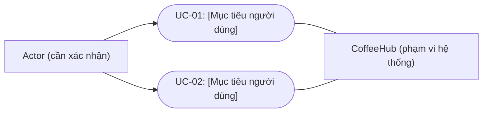

# Use Case Model

- **Trạng thái:** Draft / minh họa cấu trúc
- **Lưu ý:** Actor và use case trong sơ đồ dưới đây là placeholder, không khẳng định là chức năng thật của CoffeeHub.

## 1. Sơ đồ use case tổng quát

## 2. Mẫu đặc tả use case

| Trường | Nội dung cần điền |
|---|---|
| ID / Tên | UC-XX / [Tên mục tiêu] |
| Actor chính | [Vai trò thực hiện] |
| Mục tiêu | [Kết quả actor cần đạt] |
| Điều kiện trước | [Điều kiện để bắt đầu] |
| Kích hoạt | [Sự kiện khởi đầu] |
| Luồng chính | 1. ... 2. ... 3. ... |
| Luồng thay thế | [Nhánh hợp lệ khác] |
| Luồng ngoại lệ | [Lỗi và cách xử lý] |
| Điều kiện sau | [Trạng thái sau thành công/thất bại] |
| Yêu cầu liên quan | FR-XXX |
| Test case | TC-XXX |

## 3. Cách hoàn thiện
1. Xác nhận actor từ yêu cầu và quyền thực tế.
2. Liệt kê mục tiêu người dùng, không liệt kê từng nút giao diện như một use case riêng nếu không có mục tiêu độc lập.
3. Xác định luồng chính, nhánh thay thế và lỗi.
4. Liên kết từng use case với yêu cầu chức năng và test case.
